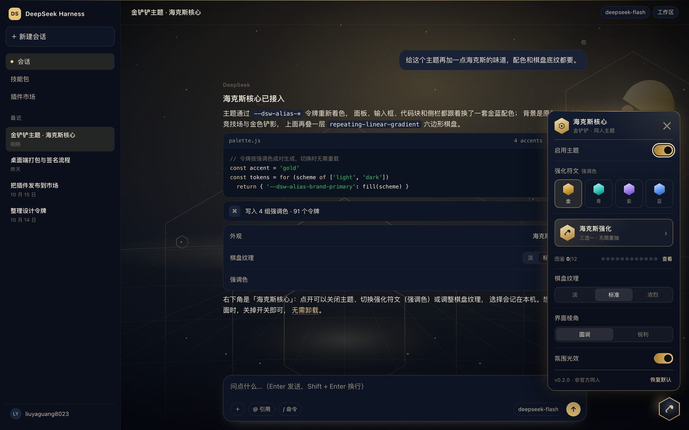
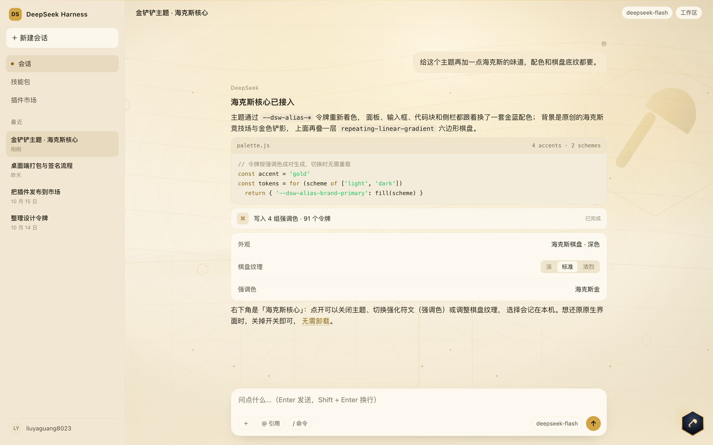
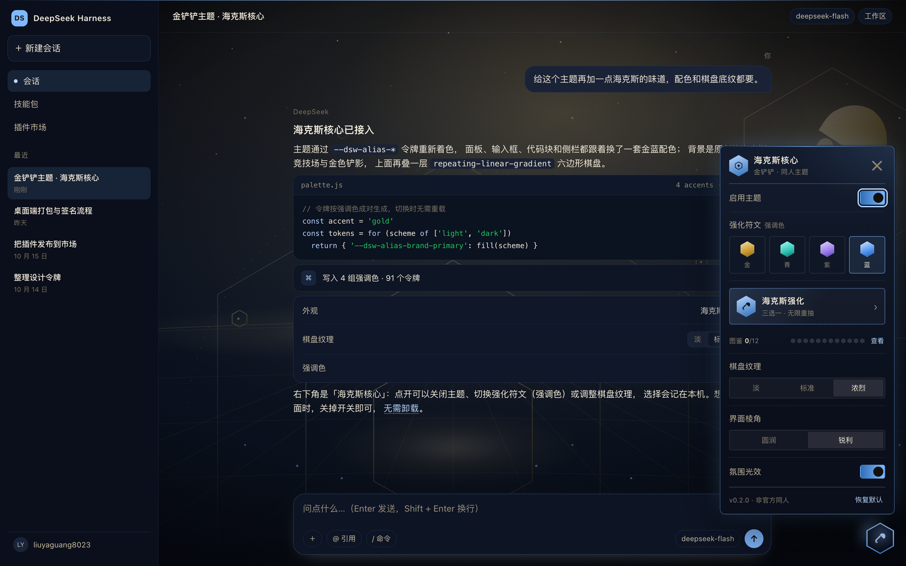
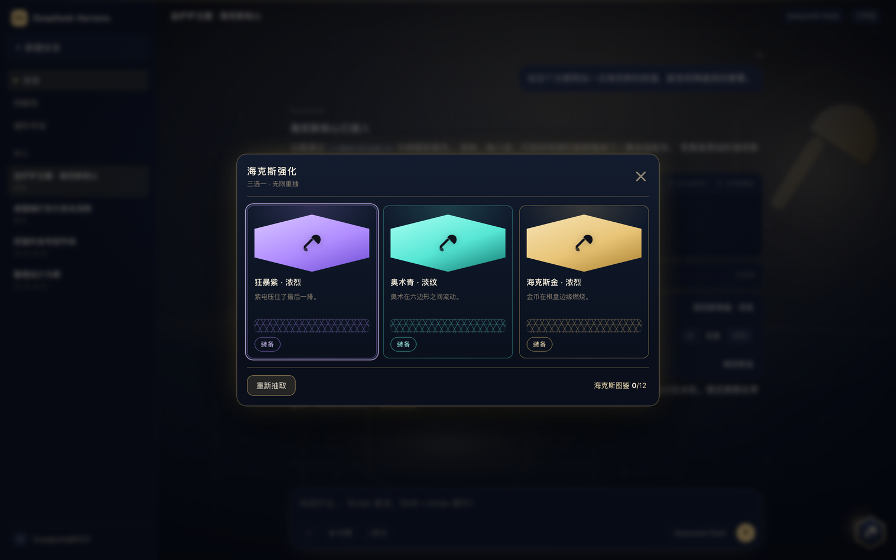

# dsh-jcc-theme — Golden Spatula · Hextech Core

An unofficial **Golden Spatula (金铲铲) fan theme** for the DeepSeek Harness Web GUI:
an original hextech arena backdrop with a golden spatula crest, hextech gold and arcane
accents, a hexagonal board lattice, and a floating hex-core launcher for switching the
accent colour and board texture — or turning the whole thing off.

> Unofficial fan work, not affiliated with Tencent or Riot Games. No game assets are
> included: every icon and pattern here is original CSS/SVG geometry. “金铲铲之战” and
> “Teamfight Tactics” are trademarks of their respective owners.



## What it does

- **Light and dark** — a parchment chart for light, an arcane arena for dark. It follows
  the host's Light / Dark / System preference; there is no second appearance switch.
- **Original backdrop** — the dark scene is a hexagonal arena with a golden spatula crest
  and floating hex crystals; the light one is an old chart with contours, a compass and the
  same crest. Both are inline SVG data URIs, so no image is ever fetched.
- **Four augments** — Hextech Gold, Arcane Cyan, Fury Violet, Astral Blue. Borders, brand
  fills, links, focus rings and sidebar selection all follow the choice, live.
- **Three board textures** — Subtle / Standard / Vivid, controlling the lattice and the
  two ambient lights behind the interface.
- **Ambience** — a slow aurora and two drifting layers of gold dust behind the app; toggle
  it in the panel, and it stays still under `prefers-reduced-motion`.
- **Corner style** — Soft / Sharp. Sharp also tightens the product's own radius tokens, so
  cards, buttons and the panel square off together.
- **Hex-core panel** — the floating hexagon in the bottom-right corner. Turn the theme
  on or off, pick an accent, pick a texture, reset to defaults. Stored locally, no
  network.
- **Off means stock** — every page-level rule is scoped to `<html data-jcc="on">`.
  Switching off (or disabling the bundle in the market) restores the stock UI instantly.

Light:



Astral Blue with the vivid board and sharp corners:



## Hextech augment draft

The **Hextech augment** entry in the panel is not a monetized gacha: it is a
three-choice draft. Draw three cards with three different accents, pick one, and its
accent + texture is equipped immediately.



- **Cosmetic only** — 12 cards = 4 accents × 3 textures (`accent + texture`). No features,
  model quota or permissions are ever drawn.
- **Nothing is locked** — every combination stays manually selectable in the panel; the
  draft is a discovery shortcut, not a gate.
- **No currency, cooldown, daily reset or rarity roll** — redraws are unlimited, and
  duplicates produce no resources.
- **Local codex** — picks are stored in `collection` inside `dsh-jcc/v1`; owned cards can
  be equipped from the codex, locked ones are silhouettes.
- **Reset keeps the codex** — the appearance reset does not clear it; clearing is a
  separate two-click action in the codex.
- **No interruption** — the card overlay only opens from a deliberate click; Esc or the
  scrim closes it and focus is trapped inside.
- **Motion is optional** — cards deal in sequence, and `prefers-reduced-motion` shows them
  immediately.

The pool is only 12 cards; completing it shows "Full codex" and nothing else. This is
appearance discovery, not a progression system.

## Install

Requires **DSH 0.2.0-rc.1 or newer** (desktop included). The plugin is browser-only: no
host service, no config schema, no commands.

Once listed: **Settings → Plugin market**, search for `dsh-jcc-theme`.

```sh
# Prebuilt tarball (recommended)
dsh plugin --profile web add "https://github.com/liuyaguang8023/dsh-jcc-theme/releases/latest/download/dsh-jcc-theme.tgz"

# Or straight from source — the built bundle is committed
dsh plugin --profile web add github:liuyaguang8023/dsh-jcc-theme
```

Refresh the page when the market asks; if the host composes bundles at startup, restart
`dsh web` once.

## Use

1. Click the hexagon in the bottom-right corner.
2. In the panel:
   - **Theme on** — master switch; off restores the stock UI completely;
   - **Hextech augment** — draw three, equip one;
   - **Augment** — gold / cyan / violet / blue accent;
   - **Board texture** — subtle / standard / vivid;
   - **Corners** — soft / sharp;
   - **Ambience** — aurora and gold dust on/off;
   - **Codex** — the 12 cards, collected and equipable;
   - **Reset** — back to Hextech Gold, standard board, soft corners, ambience on (the
     codex is kept).
3. Click outside or press `Esc` to close.

The choice lives in `localStorage` under `dsh-jcc/v1`
(`{"on":true,"accent":"gold","texture":"normal","ambience":true,"corners":"soft","collection":[]}`). Nothing is uploaded.

## How it works

- **Colour** — `src/client.js` generates `--dsw-alias-*` tokens per accent and scheme,
  scoped to selectors more specific than the product's own
  `body[data-ds-dark-theme]` rule, so overrides win and revert cleanly.
- **Backdrop** — two original SVG scenes are encoded into data URIs at build time and used
  as the first `body` background layer, followed by three `repeating-linear-gradient`s
  (0° / ±60°) and two radial ambient lights. `background-attachment: fixed` keeps the whole
  layer still while messages scroll. The app frame and each page root cover that canvas with `--dsw-alias-bg-base`,
  so the client marks only the full-viewport canvas layers transparent at runtime —
  sticky headers, cards and attachments keep their opaque fill.
- **Ambience** — a fixed `z-index: -1` layer: two dust fields drift with `transform`, the
  aurora breathes with a radial gradient. The canvas layers are transparent, so it stays
  behind the interface and never covers text.
- **Corners** — sharp mode overrides both the panel's own radii and the product's
  `--dsw-radius-*` tokens, so cards, buttons and the panel change together.
- **Draft** — the 12 cards are exactly the 4 × 3 `accent + texture` pairs. A draw picks
  three different accents and one random texture each, so the three cards are always three
  colours. A pick calls `setState` once; the codex lives in the same `localStorage` key
  and adds no requests.
- **Panel** — plain DOM and CSS. No React, no `slots`, no host API, so a component rename
  in a future host cannot break it; only the stable `data-ds-dark-theme` attribute and
  the design tokens are coupled.
- **Build** — `client/index.js` is assembled from `src/client.js` + `src/theme.css` and
  committed, so a source install needs no build step.

## Development

```sh
npm run build      # rebuild client/index.js
npm test           # manifest + palette contract
npm run test:dom   # exercise the UI in headless Chrome

open preview/index.html   # local preview against a snapshot of the real tokens
node scripts/shoot.mjs    # regenerate assets/ screenshots
```

`preview/tokens.css` is a snapshot of the DSH 0.2.1-rc.2 theme tokens, used by the preview
only and not shipped.

## License

MIT. See [LICENSE](LICENSE).
