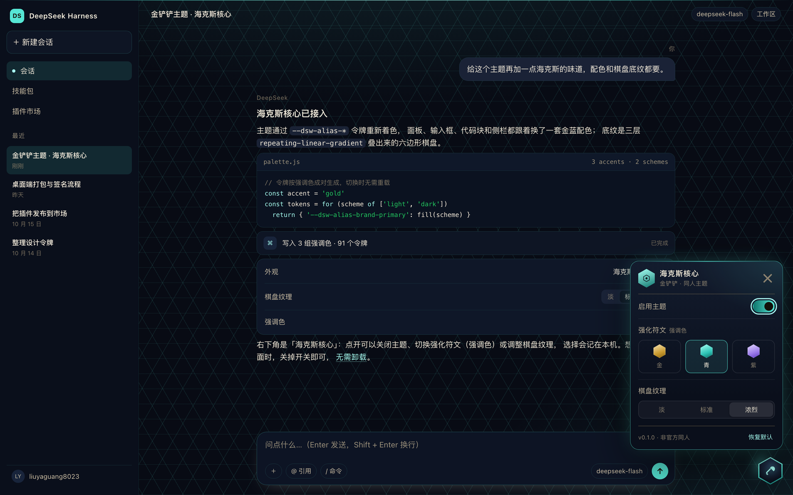

# dsh-jcc-theme — Golden Spatula · Hextech Core

An unofficial **Golden Spatula (金铲铲) fan theme** for the DeepSeek Harness Web GUI:
hextech gold and arcane accents, a hexagonal board lattice behind the interface, and a
floating hex-core launcher for switching the accent colour and board texture — or turning
the whole thing off.

> Unofficial fan work, not affiliated with Tencent or Riot Games. No game assets are
> included: every icon and pattern here is original CSS/SVG geometry. “金铲铲之战” and
> “Teamfight Tactics” are trademarks of their respective owners.


## What it does

- **Light and dark** — parchment board for light, arcane navy for dark. It follows the
  host's Light / Dark / System preference; there is no second appearance switch.
- **Three augments** — Hextech Gold, Arcane Cyan, Fury Violet. Borders, brand fills,
  links, focus rings and sidebar selection all follow the choice, live.
- **Three board textures** — Subtle / Standard / Vivid, controlling the lattice and the
  two ambient lights behind the interface.
- **Hex-core panel** — the floating hexagon in the bottom-right corner. Turn the theme
  on or off, pick an accent, pick a texture, reset to defaults. Stored locally, no
  network.
- **Off means stock** — every page-level rule is scoped to `<html data-jcc="on">`.
  Switching off (or disabling the bundle in the market) restores the stock UI instantly.

Light:


Arcane Cyan with the vivid board:



## Install

Requires **DSH 0.2.0-rc.1 or newer** (desktop included). The plugin is browser-only: no
host service, no config schema, no commands.

Once listed: **Settings → Plugin market**, search for `dsh-jcc-theme`.

```sh
# Prebuilt tarball (recommended)
dsh plugin --profile web add "https://github.com/liuyaguang8023/dsh-jcc-theme/releases/latest/download/dsh-jcc-theme.tgz"

# Or straight from source — the built bundle is committed
dsh plugin --profile web add github:liuyaguang8023/dsh-jcc-theme
```

Refresh the page when the market asks; if the host composes bundles at startup, restart
`dsh web` once.

## Use

1. Click the hexagon in the bottom-right corner.
2. In the panel:
   - **Theme on** — master switch; off restores the stock UI completely;
   - **Augment** — gold / cyan / violet accent;
   - **Board texture** — subtle / standard / vivid;
   - **Reset** — back to Hextech Gold with the standard board.
3. Click outside or press `Esc` to close.

The choice lives in `localStorage` under `dsh-jcc/v1`
(`{"on":true,"accent":"gold","texture":"normal"}`). Nothing is uploaded.

## How it works

- **Colour** — `src/client.js` generates `--dsw-alias-*` tokens per accent and scheme,
  scoped to selectors more specific than the product's own
  `body[data-ds-dark-theme]` rule, so overrides win and revert cleanly.
- **Texture** — three `repeating-linear-gradient`s (0° / ±60°) form the lattice, with two
  radial ambient lights; `background-attachment: fixed` keeps it still while messages
  scroll. The app frame and each page root cover that canvas with `--dsw-alias-bg-base`,
  so the client marks only the full-viewport canvas layers transparent at runtime —
  sticky headers, cards and attachments keep their opaque fill.
- **Panel** — plain DOM and CSS. No React, no `slots`, no host API, so a component rename
  in a future host cannot break it; only the stable `data-ds-dark-theme` attribute and
  the design tokens are coupled.
- **Build** — `client/index.js` is assembled from `src/client.js` + `src/theme.css` and
  committed, so a source install needs no build step.

## Development

```sh
npm run build      # rebuild client/index.js
npm test           # manifest + palette contract
npm run test:dom   # exercise the UI in headless Chrome

open preview/index.html   # local preview against a snapshot of the real tokens
node scripts/shoot.mjs    # regenerate assets/ screenshots
```

`preview/tokens.css` is a snapshot of the DSH 0.2.1-rc.2 theme tokens, used by the preview
only and not shipped.

## License

MIT. See [LICENSE](LICENSE).
